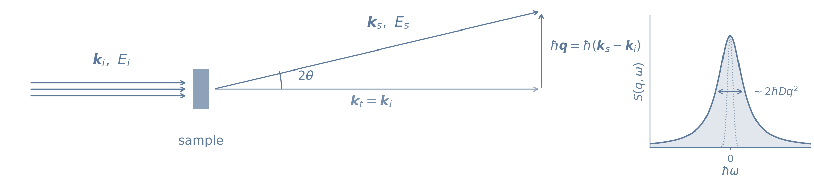
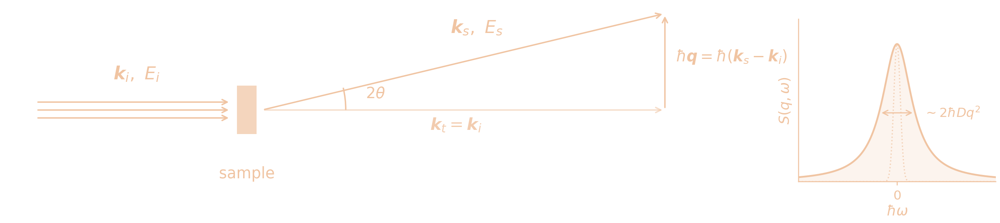

.. _qens-explanations:

================================
Quasi-elastic neutron scattering
================================

Where Small-Angle X-ray Scattering (SAXS, see :ref:`saxs-explanations`) probes static
structure through the elastic scattering of photons, Quasi-elastic Neutron Scattering
(QENS) probes *dynamics* through the small but non-zero energy transferred when neutrons
scatter off moving nuclei. Neutrons are particularly well-suited for this task: they
scatter from nuclei rather than electron clouds, they penetrate deeply into condensed
matter, and the energy of a thermal neutron is comparable to the energy of molecular
motions on the picosecond timescale, so the energy exchanged in a scattering event is
directly readable in the spectrum.

QENS spectra contain information about diffusion, rotational motion, and the residence
times of molecules in local environments. In the time domain, this dynamical information
is encoded in the *intermediate scattering function* :math:`F(q, t)`, which is what
:class:`scatterkit.Qens` computes from a molecular dynamics trajectory.

-----------
Experiments
-----------

A QENS experiment is closely related to a SAXS experiment, with the key difference that
both the wave vector :math:`\boldsymbol q` *and* the energy transfer :math:`\hbar\omega`
of the scattered particle are resolved. A monochromatic neutron beam of wave vector
:math:`\boldsymbol k_i` impinges on the sample, and the energy and direction of the
scattered neutrons are measured. The setup is sketched below.

The momentum and energy transferred to the sample are

.. math::
    \hbar \boldsymbol q = \hbar (\boldsymbol k_s - \boldsymbol k_i)
    \,, \qquad
    \hbar \omega = \frac{\hbar^2}{2 m_n} (|\boldsymbol k_i|^2 - |\boldsymbol k_s|^2) \,,

where :math:`m_n` is the neutron mass. Pure elastic scattering corresponds to
:math:`\omega = 0`; QENS is the regime of small but non-zero :math:`\omega`, where the
elastic line is broadened by the diffusive motion of the scatterers.

The measured quantity is the *dynamic structure factor* :math:`S(\boldsymbol q,
\omega)`. By the Wiener-Khinchin theorem, it is the time-Fourier transform of the
intermediate scattering function

.. math::
    S(\boldsymbol q, \omega) =
        \frac{1}{2\pi} \int_{-\infty}^{\infty}
        F(\boldsymbol q, t) e^{-i \omega t} \,\mathrm{d}t \,.

Neutrons interact with nuclei through two channels with different coupling strengths,
which gives rise to two contributions:

* the *coherent* part :math:`F(\boldsymbol q, t)` reports on collective density
  fluctuations (pairs of atoms),
* the *incoherent* part :math:`F_s(\boldsymbol q, t)` reports on single-particle
  motion.

For elements with a large incoherent cross-section — hydrogen in particular — the QENS
spectrum is dominated by the incoherent channel, which makes it a direct probe of
self-diffusion. :class:`scatterkit.Qens` targets this regime.

-----------
Simulations
-----------

In molecular dynamics simulations the incoherent intermediate scattering function can be
computed directly from the trajectory:

.. math::
    F_s(\boldsymbol q, t) =
        \frac{1}{N} \left\langle \sum_{i=1}^{N}
        \exp\!\big( i\, \boldsymbol q \cdot
            [\boldsymbol r_i(t_0 + t) - \boldsymbol r_i(t_0)] \big)
        \right\rangle_{t_0} \,,

where the average is taken over time origins :math:`t_0` and :math:`\boldsymbol r_i(t)`
is the position of atom :math:`i` at time :math:`t`. The coherent counterpart includes
cross-terms :math:`i \neq j` and reduces to the static structure factor
:math:`S(\boldsymbol q)` (see :ref:`saxs-explanations`) at :math:`t = 0`.

As in the static case, :math:`\boldsymbol q` is restricted by the periodic boundary
conditions to wave vectors of the form

.. math::
    \boldsymbol q = 2 \pi (n_x / L_x, n_y / L_y, n_z / L_z) \,, \qquad
    n_x, n_y, n_z \in \mathbb{Z} \,,

with box lengths :math:`L_x, L_y, L_z`. For each requested :math:`q`-shell,
:class:`scatterkit.Qens` enumerates all lattice-compatible orientations of
:math:`\boldsymbol q` and powder-averages the resulting per-vector correlations into a
single :math:`F_s(q, t)` curve. This averaging recovers the isotropy that the discrete
:math:`q`-grid does not have for any individual vector.

.. Note::
    :class:`scatterkit.Qens` currently supports only orthorhombic simulation cells.
    Triclinic boxes would require the full reciprocal-lattice basis rather than the
    axis-aligned grid above.

Rather than storing the full trajectory of phase factors and then correlating in a
post-processing step, :class:`scatterkit.Qens` streams the per-atom phases
:math:`e^{i \boldsymbol q \cdot \boldsymbol r_i(t)}` into a *multi-tau* correlator
(:class:`multitau.MultiTauCorrelator`). The multi-tau scheme uses
geometrically spaced lag-time channels, so the function is sampled densely at short
times and coarsely at long times while the memory cost stays bounded by the number of
levels rather than by the trajectory length. This is the natural sampling for a
correlation function that decays roughly exponentially over many decades in time, as is
typical for diffusive motion.

----------------------------------------------------
Connection to the mean-squared displacement
----------------------------------------------------

For homogeneous, isotropic, and Gaussian-distributed displacements,

.. math::
    P(\Delta \boldsymbol r, t) =
        \left( \frac{3}{2 \pi \langle \Delta r^2(t) \rangle} \right)^{3/2}
        \exp\!\left( - \frac{3 \,|\Delta \boldsymbol r|^2}
                            {2 \langle \Delta r^2(t) \rangle} \right) \,,

the angular integral in the definition of :math:`F_s` can be carried out analytically
and yields the *Gaussian approximation*

.. math::
    F_s(q, t) = \exp\!\left( - \frac{q^2 \langle \Delta r^2(t) \rangle}{6} \right) \,,

where :math:`\langle \Delta r^2(t) \rangle = \langle |\boldsymbol r_i(t_0 + t) -
\boldsymbol r_i(t_0)|^2 \rangle` is the mean-squared displacement (MSD). The Gaussian
approximation is exact for free Brownian diffusion and for any harmonic system, and is
generally a good approximation at long times where the central-limit theorem applies. In
this regime :math:`\langle \Delta r^2(t) \rangle = 6 D t` and

.. math::
    F_s(q, t) \approx \exp(- D q^2 t) \,,

so the time-Fourier transform that yields the experimental dynamic structure factor is a
Lorentzian of half-width :math:`D q^2`. Fitting this width as a function of :math:`q` is
the standard way of extracting self-diffusion coefficients from QENS spectra.

Deviations of the simulated :math:`F_s(q, t)` from a single exponential — or from the
Gaussian approximation — are themselves physically meaningful. They signal sub-diffusive
behaviour, jump diffusion, or coupling between translation and rotation. For a detailed
discussion of these regimes and of the relation between :math:`F(q, t)`, :math:`F_s(q,
t)`, and the van Hove correlation function, see :footcite:p:`hansen_theory_2006`.

References
----------
.. footbibliography::
